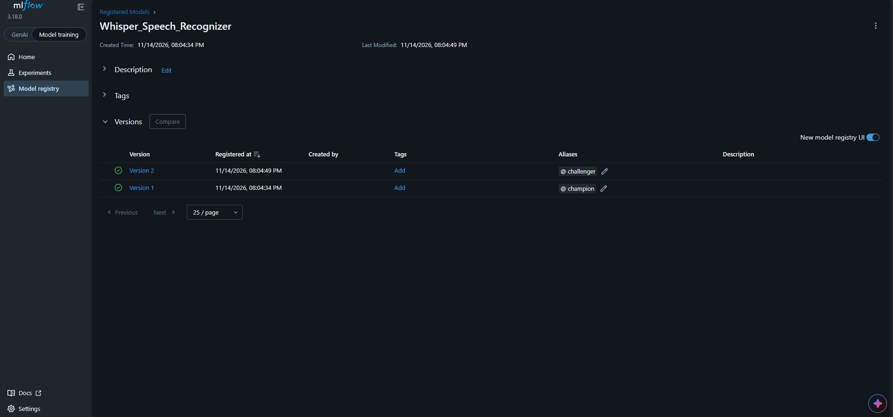
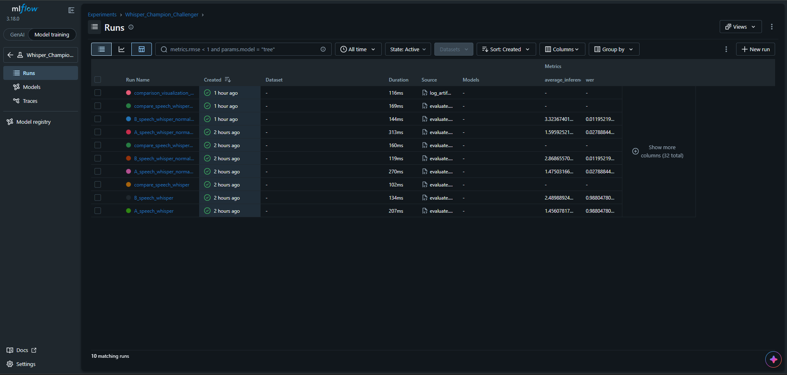
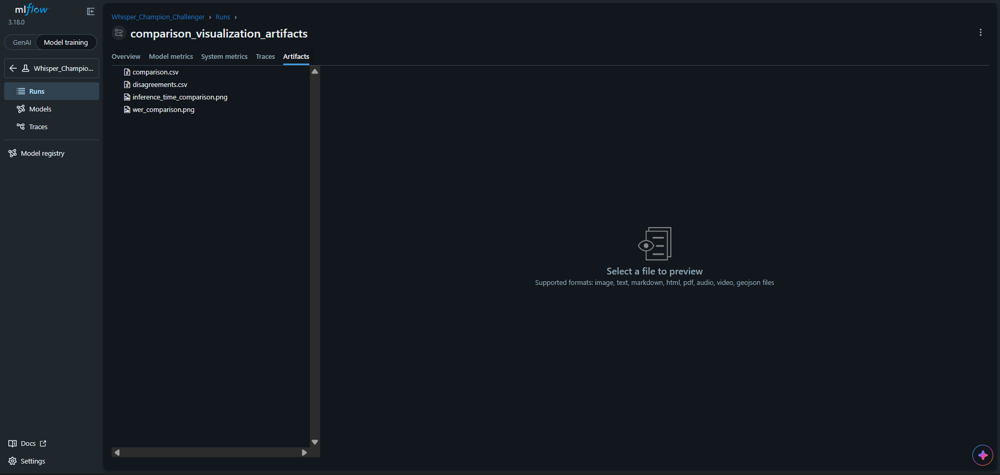
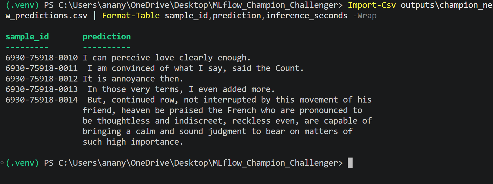

# Champion–Challenger Model Comparison using Hugging Face and MLflow

**USN:** 1MS25CI014  
**Project:** Champion–Challenger Model Comparison  
**Task:** English Speech Recognition

## 1. Project Overview

This project compares two Hugging Face Whisper models using the LibriSpeech test-clean dataset.

The objective is to evaluate both models on identical audio samples, track their performance using MLflow, select a champion model, register both models, and use the registered champion for predictions on new audio samples.

### Models Compared

| Model | Hugging Face Model |
|---|---|
| Model A | openai/whisper-tiny |
| Model B | openai/whisper-base |

## 2. Champion Selection Rule

The models are evaluated using the same 10 audio recordings.

The selection criteria are:

1. Word Error Rate (WER): Lower is better.
2. Average inference time: Lower is better.

The model with the lowest WER is selected as the champion.

If both models have the same WER, the model with the lower average inference time is selected.

The other model is designated as the challenger.

## 3. Dataset

**Dataset:** LibriSpeech ASR  
**Subset:** test-clean  
**Task:** English Speech Recognition

- Evaluation samples: 10 audio recordings
- New samples: 5 audio recordings
- Audio format: FLAC
- Reference transcripts are used to evaluate model predictions.

The same evaluation samples are provided to both models to ensure a fair comparison.

## 4. Technologies Used

- Python 3.13
- Hugging Face Transformers
- Whisper Tiny and Whisper Base
- PyTorch (CPU)
- MLflow 3.18
- Pandas
- SoundFile
- Matplotlib
- Git and GitHub

## 5. Evaluation Methodology

Both models are loaded using Hugging Face Transformers and evaluated on the same 10 audio samples.

The evaluation process includes:

1. Loading the audio recordings.
2. Generating speech-to-text predictions.
3. Normalizing reference and predicted text by converting to lowercase and removing punctuation.
4. Calculating Word Error Rate (WER).
5. Measuring inference time.
6. Logging parameters, metrics, predictions, and artifacts in MLflow.

## 6. Evaluation Results

The following results were obtained from the successful normalized evaluation runs.

| Metric | Whisper Tiny | Whisper Base |
|---|---:|---:|
| WER | 0.027888 | 0.011952 |
| Average Inference Time (seconds) | 1.595925 | 3.323674 |

### Result

**Champion:** openai/whisper-base

**Challenger:** openai/whisper-tiny

Whisper Base achieved a lower WER, making it the champion according to the predefined selection rule.

Whisper Tiny was faster, but its WER was higher.

## 7. MLflow Tracking

MLflow is used to track model experiments and compare their performance.

The experiment name is:

`Whisper_Champion_Challenger`

The project includes the following evaluation runs:

- A_speech_whisper_normalized
- B_speech_whisper_normalized
- compare_speech_whisper_normalized

The project also logs comparison visualizations and CSV artifacts.

### Logged Metrics

- Word Error Rate (WER)
- Average inference time

### Logged Artifacts

- A_predictions.csv
- B_predictions.csv
- comparison.csv
- disagreements.csv
- wer_comparison.png
- inference_time_comparison.png

## 8. Model Registration

Both models are registered under the same MLflow registered model name:

`Whisper_Speech_Recognizer`

| Model | Version | Alias |
|---|---:|---|
| Whisper Base | 1 | champion |
| Whisper Tiny | 2 | challenger |

The champion alias points to Whisper Base, and the challenger alias points to Whisper Tiny.

## 9. New Sample Predictions

The registered champion model is loaded using its MLflow alias:

`models:/Whisper_Speech_Recognizer@champion`

Five new audio samples, not used during evaluation, are passed to the registered champion model.

The predictions are saved in:

`outputs/champion_new_predictions.csv`

The output contains:

- Sample ID
- Predicted transcription
- Inference time

## 10. Model Disagreement Analysis

The predictions from Whisper Tiny and Whisper Base are compared to identify differences.

Four unique disagreements were observed among the 10 evaluation samples.

These differences are recorded in:

`outputs/disagreements.csv`

The file includes the sample IDs, model predictions, and comments explaining the differences.

Only four unique disagreements were observed; no additional disagreements were fabricated.

## 11. Project Structure

```text
1MS25CI014-mlflow-champion-challenger/
│
├── data/
│   ├── evaluation_audio/
│   ├── new_audio/
│   ├── evaluation.csv
│   └── new_data.csv
│
├── outputs/
│   ├── A_predictions.csv
│   ├── B_predictions.csv
│   ├── champion_new_predictions.csv
│   ├── comparison.csv
│   ├── disagreements.csv
│   ├── create_plots.py
│   ├── wer_comparison.png
│   └── inference_time_comparison.png
│
├── screenshots/
│   ├── 01_model_registry.png
│   ├── 02_experiment_runs.png
│   ├── 03_mlflow_artifacts.png
│   └── 04_champion_predictions.png
│
├── prepare_data.py
├── evaluate.py
├── log_artifacts.py
├── register_champion.py
├── predict_from_mlflow.py
├── requirements.txt
├── .gitignore
└── README.md
```

## 12. Installation and Execution

### Step 1: Clone the repository

```bash
git clone https://github.com/AnanyaHundekar/1MS25CI014-mlflow-champion-challenger.git
cd 1MS25CI014-mlflow-champion-challenger
```

### Step 2: Create a virtual environment

```bash
python -m venv .venv
```

Activate it on Windows:

```powershell
.venv\Scripts\Activate.ps1
```

### Step 3: Install dependencies

```bash
pip install -r requirements.txt
```

### Step 4: Prepare the dataset

```bash
python prepare_data.py
```

### Step 5: Evaluate both models

```bash
python evaluate.py
```

### Step 6: Log comparison artifacts

```bash
python log_artifacts.py
```

### Step 7: Register the models

```bash
python register_champion.py
```

### Step 8: Generate predictions using the champion

```bash
python predict_from_mlflow.py
```

### Step 9: View MLflow

```bash
mlflow ui --backend-store-uri sqlite:///mlflow.db
```

Open the following address in your browser:

http://127.0.0.1:5000

## 13. Screenshots

### Model Registry



### Experiment Runs and Metrics



### MLflow Artifacts



### Champion Predictions on New Data



## 14. Conclusion

This project demonstrates the Champion–Challenger approach to machine learning model evaluation and management.

Whisper Tiny and Whisper Base were evaluated using identical audio samples. Their performance was compared using WER and inference time, and the results were tracked using MLflow.

Whisper Base achieved the lowest WER and was selected as the champion, while Whisper Tiny was registered as the challenger.

Both models were registered in MLflow, and the champion model was successfully used to generate predictions on five new audio samples.

The project demonstrates model evaluation, experiment tracking, artifact logging, model registration, alias-based model loading, and inference using Hugging Face and MLflow.
